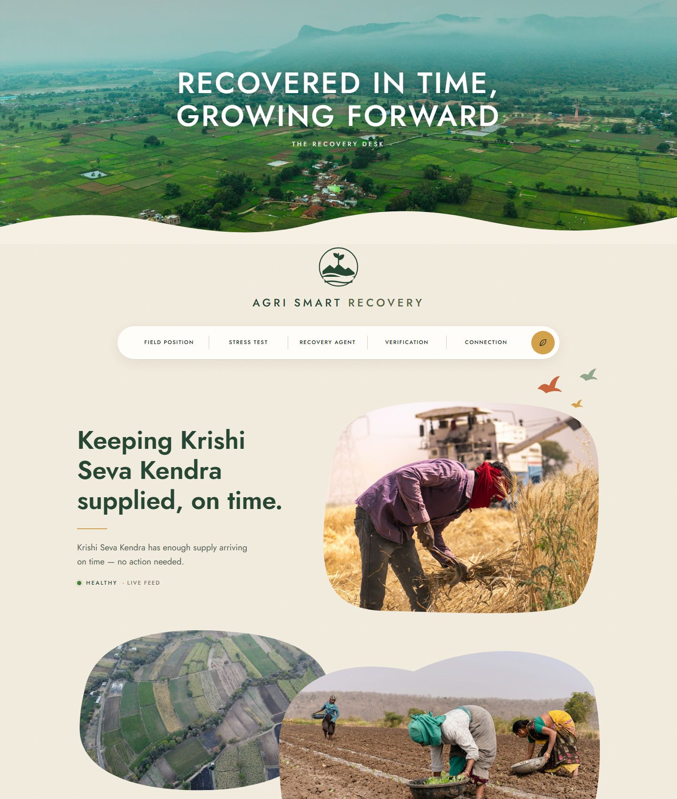
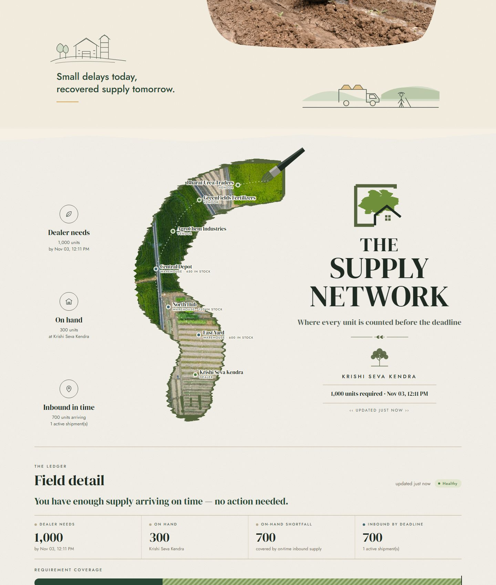
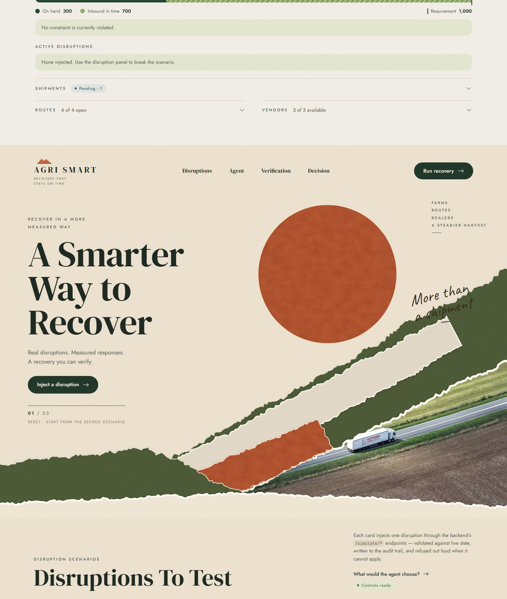
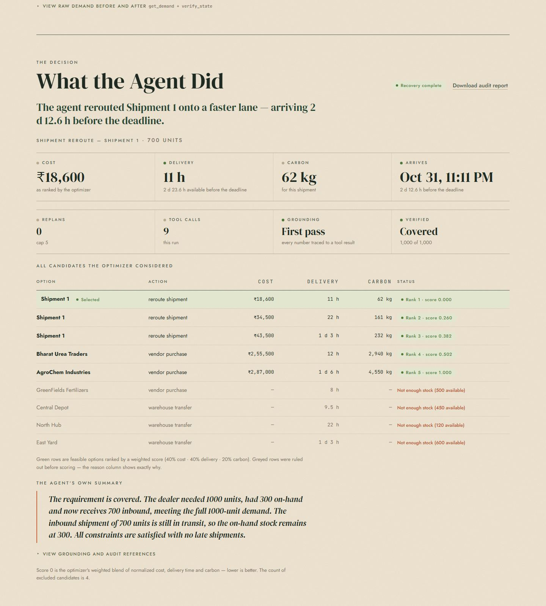

# Agri Smart Supply-Chain Recovery Agent

> **The problem:** an agricultural supply chain gets hit by a disruption (a delayed shipment, a
> failed vendor, a blocked route, a demand spike) while a dealer waits on a hard delivery deadline.
> **The system:** detects the violated constraint, ranks every feasible recovery option on cost,
> delivery time and carbon, executes the best one — and explains itself in plain language, with
> every number traceable to the data it came from.

An **agentic recovery system for agricultural supply chains**, in two parts:

| Part | Stack | What it is |
|---|---|---|
| [`supply-chain-agent-backend`](supply-chain-agent-backend/README.md) | Python · FastAPI · SQLAlchemy · SQLite | Entities, a resettable seed scenario, validated & audited recovery actions, disruption triggers, a deterministic recovery optimizer and the agent loop that orchestrates it all |
| [`frontend`](frontend/README.md) | TypeScript · React · Vite | An illustrated operator console: the live supply network, disruption controls, and the agent's reasoning trace in plain language |

**Jump to:** [demo video script](demo-video-script.md) · [problem & solution brief](problem-and-solution-brief.md) · [architecture](project-architecture.md) ·
[backend README](supply-chain-agent-backend/README.md) · [frontend README](frontend/README.md) · [evaluation](supply-chain-agent-backend/EVALUATION.md) · [security](supply-chain-agent-backend/SECURITY.md)

## A look at the console

The console is one long illustrated page in three spreads — a field hero, a poster of the
live supply network, and a torn-paper collage that holds the stress test and the agent.
Everything on it is wired to the backend: the headline, the route pins and the figures are
live, and every control calls a real endpoint.

| | |
|---|---|
|  |  |
| **Field hero** — the dealer's live position, stated in one sentence | **Supply network** — vendors, warehouses and the dealer plotted along the route |
|  |  |
| **Stress test** — break the network, then run recovery | **The decision** — every candidate the optimizer weighed, and why |

## Run it

```bash
# 1 — backend
cd supply-chain-agent-backend
python -m venv .venv && source .venv/Scripts/activate   # Windows Git Bash; .venv/bin/activate on macOS/Linux
pip install -r requirements.txt
API_KEY=pick-a-key uvicorn app.main:app --port 8000      # http://127.0.0.1:8000/docs

# 2 — console
cd ../frontend
npm install
npm run dev                                              # http://localhost:5173
```

Then paste `pick-a-key` into the console's **Link to the Backend** section (at the foot of the page). On first start the backend
creates `supply_chain.db` and seeds it automatically; `POST /admin/reset` returns it to the
starting state at any time. All 264 backend tests run offline with no API key:

```bash
cd supply-chain-agent-backend && python -m pytest -q
```

## The one-minute version

1. A dealer needs **1,000 bags of urea** within 72 h and holds 300 — a 700-bag shipment is en route.
2. A disruption lands (say, the shipment is delayed past the deadline). The system detects the
   violated constraint from live data.
3. A **pure, deterministic optimizer** ranks every feasible way to close the gap — warehouse
   transfers and vendor purchases — scoring cost (40%), delivery time (40%) and carbon (20%),
   and explains every rejection.
4. The **agent** executes the top-ranked option through validated, atomic, audited actions —
   then re-verifies the state and reports the outcome.
5. The agent **never computes a number and never invents one**: arithmetic lives in the optimizer,
   and any figure in its final prose is checked against the recorded tool results before it is shown.

## Repository layout

```
frontend/                          React operator console (Vite + TypeScript)
docs/screenshots/                  console screenshots used in this README
supply-chain-agent-backend/        FastAPI service — the whole system lives under app/
  app/routers/                     HTTP endpoints (CRUD, read views, actions, simulate, agent)
  app/services/                    validation, transactions, audit — the only mutator
  app/agent/                       tools, loop, trace, grounded explanation
  app/optimizer.py                 the pure recovery optimizer (no DB, no clock, no LLM)
  app/db/                          models, session, resettable seed scenario
  tests/                           264 offline tests
  demo.py / evaluate.py            single-scenario demo + N-run evaluation sweep
problem-and-solution-brief.md      the problem statement and how this solves it
project-architecture.md            system architecture and request/response flows
demo-video-script.md               shot-by-shot script for the 3–5 minute demo video
```

## Safety properties (the short list)

- Every state-changing endpoint requires `X-API-Key`, compared in constant time — 34 write
  operations are covered. Reads are rate-limited; the agent trigger is capped at 10/min.
- Mutating actions are validated against current DB state, applied atomically with their audit
  entry, and refused with a machine-readable `reason` when infeasible — a refused action leaves no trace.
- The LLM has no database, shell or HTTP client: ten tools are its entire reach, three of them
  mutate and all three route through the same validator a human caller uses.
- Bounded autonomy: at most 5 replan cycles and 15 tool calls per cycle; a refused action is never retried.
- `GROQ_API_KEY` is optional — unset, a deterministic template writes the explanation and the
  whole system runs offline. No credential is committed; see the `.env.example` files.

## Docs map

| Document | Read it for |
|---|---|
| [Problem & solution brief](problem-and-solution-brief.md) | The problem statement, constraints and the solution approach |
| [Project architecture](project-architecture.md) | Layers, data flow, the agent loop, and why each piece sits where it does |
| [Demo video script](demo-video-script.md) | A 3–5 minute shot-by-shot script with real numbers from a logged run |
| [Backend README](supply-chain-agent-backend/README.md) | API reference, data models, seed scenario, security and configuration |
| [Frontend README](frontend/README.md) | The console's sections, visual design, polling and auth layer |
| [Evaluation](supply-chain-agent-backend/EVALUATION.md) | Measured results over 8 runs — and an honest reading of them |
| [Presentation notes](supply-chain-agent-backend/PRESENTATION.md) | Approach, challenges, and the original presentation summary |
| [Security](supply-chain-agent-backend/SECURITY.md) | Every security measure and its reasoning |
