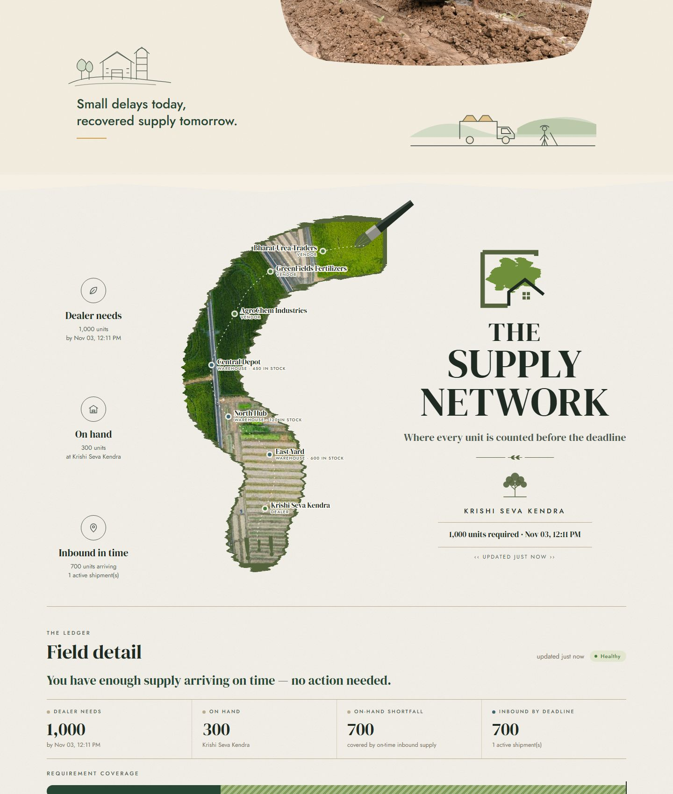

# Agri Smart Recovery — Console

The operator console for the supply-chain recovery agent: the live supply
network, the disruption controls used to break the scenario, and the agent's
reasoning trace rendered in plain language.

Built with **Vite + React + TypeScript**. No UI framework and no chart library —
the illustration is hand-built SVG, and one stylesheet holds the whole visual
system, so a state always reads the same way wherever it appears.



## Quickstart

Two processes: the backend from the previous steps, and this console.

```bash
# terminal 1 — the backend
cd ../supply-chain-agent-backend
pip install -r requirements.txt
API_KEY=pick-a-key uvicorn app.main:app --port 8000

# terminal 2 — this console
npm install
npm run dev        # http://localhost:5173
```

Then paste `pick-a-key` into the **API key** field under *Link to the Backend*,
at the foot of the page. The controls stay locked until you do.

**Why the console serves on `localhost:5173` specifically:** the backend's default
`CORS_ORIGINS` is exactly `http://localhost:5173`, so a freshly started backend
needs no configuration. If you serve from another origin, add it to the backend's
`CORS_ORIGINS` or the browser will block every request — the console will tell
you so rather than failing silently.

**Demo walkthrough** (the flow the console is built around):

1. `Reset scenario` under *Link to the Backend* to start from the seeded state.
2. Break something from the *Disruptions To Test* cards — delay the shipment,
   block a route, disable a vendor, or raise demand.
3. Watch the headline turn terracotta, the route pins change, and the disruption
   appear in the ledger under *Active disruptions*.
4. `Run recovery` (in the collage's top bar or the agent section) and watch the
   agent's reasoning appear step by step.
5. Read the outcome: cost, delivery against the deadline, carbon, replans, and the
   before/after numbers.

The `01 / 03` counter in the collage tracks this walkthrough from live state:
reset, then a disruption in effect, then a completed run.

## Scripts

| Command | What it does |
|---|---|
| `npm run dev` | Dev server on `localhost:5173` |
| `npm run typecheck` | `tsc --noEmit` — the whole app is strictly typed, no `any` escapes |
| `npm run build` | Production bundle into `dist/` |
| `npm run check` | Typecheck then build |

## The page

One long page in three spreads, top to bottom:

| Spread | Section | Component | Reads |
|---|---|---|---|
| Field hero | Live headline and status | `sections/FieldHero` | the snapshot below |
| Supply network | Route poster | `sections/NetworkPoster` | `/demand`, `/vendors`, `/inventory` |
| | Field detail ledger | `SystemStatusPanel` | `/demand`, `/shipments`, `/routes`, `/vendors`, `/inventory` |
| Stress test | Collage and *Run recovery* | `sections/RecoveryHero` | `POST /agent/recover` |
| | Disruptions To Test | `DisruptionPanel` | the four `/simulate/*` endpoints |
| | How the Agent Reasons | `AgentFeed` | `POST /agent/recover` (the reasoning trace) |
| | Before & After | `BeforeAfterCard` | `get_demand` before the run, `verify_state` after |
| | What the Agent Did | `OutcomeCard` | the run's plan, actions, verification and grounding |
| | Link to the Backend | `ConnectionPanel` | `/health` |

The headline in the field hero is written from the snapshot, not as a slogan —
"Keeping Krishi Seva Kendra supplied, on time." becomes "Krishi Seva Kendra is
short. Time to recover." the moment the constraint breaks. The poster's route
pins are the real vendors, warehouses and dealer, and turn terracotta when a
vendor is disabled or the dealer is short.

### Visual system

* **Type** — DM Serif Display for headlines and figures, Jost for body text and
  spaced capitals, Caveat for the one handwritten note, JetBrains Mono for data.
  All self-hosted through `@fontsource`; nothing loads from a font CDN.
* **Paper** — each spread has its own stock (warm cream, off-white, kraft) with a
  fine SVG grain. Torn edges come from `src/art/torn.ts`, which tears polygon
  edges with a seeded generator so they tear the same way on every render.
* **Colour** — one meaning per colour, everywhere: **moss** healthy / verified /
  improved, **ochre** degraded / advisory / still-short, **terracotta** violated /
  blocked / failed, **slate** neutral information, **stone** inert. Forest green
  is the brand ink for primary actions and never means "healthy".
* **Motion** — kept to the live indicator, the spinner and the slow-turning
  footer stamp; all of it stops under `prefers-reduced-motion`.

### Photography

The photographs in `public/images/` are from Unsplash, used under the
[Unsplash License](https://unsplash.com/license); `public/images/CREDITS.md`
links each one to its source.

### Reading the agent's run

The trace arrives from the backend as JSON. `src/lib/describe.ts` is the single
place that turns it into sentences, and it does so by reading the fields out of
each step's **own recorded result** — the numbers shown are the ones the tool
returned, not restatements. This mirrors the backend's own grounding rule, so the
console cannot drift into claiming something the run did not.

Two consequences that show up in the UI:

* Every step has a **`view tool call`** toggle holding the exact payload. Plain
  language by default, raw JSON one click away, and the two always correspond.
* Where the backend reports two verdicts that look contradictory, the console
  explains them rather than picking one. After a purchase, `constraint_violated`
  stays true (stock on hand is still short) while `satisfied` becomes true (the
  requirement is covered by deliveries already on the way). The verify step and
  the before/after card both say so explicitly.

**On "real time".** The backend returns the whole trace in one response — it has
no streaming endpoint — so the console cannot watch the agent think. It shows a
spinner while the request is in flight, then reveals the recorded steps in order
(about 320 ms apart, with a **Skip** button). The steps, their order and their
numbers are the backend's; only the timing of the reveal is the UI's.

## Architecture

```
src/
  api/
    client.ts     the ONLY module that calls fetch; owns the auth layer
    types.ts      hand-written mirrors of the backend's response schemas
    hooks.ts      polling hooks + localStorage-backed settings
  lib/
    describe.ts   reasoning trace -> plain language (+ status labels/tones)
    disruptions.ts  audit trail + live state -> active disruption list
    supply.ts     derived supply figures and location names
    format.ts     numbers, money, durations, dates
    read.ts       safe accessors for the raw JSON in trace results
  state/
    useAgentRun.ts  the run's lifecycle and the progressive reveal
  components/       one component per panel, plus shared pill/stat/details bits
  sections/         the illustrated spreads: hero, poster, collage, footer
  art/
    Defs.tsx        shared SVG filters (paper grain, pigment, lift, bristle)
                    and the organic photo-frame clip paths
    Icons.tsx       emblems, line sketches and icons, one stroke vocabulary
    torn.ts         seeded torn-paper edge geometry
  styles.css        the whole visual system, in one file
public/images/      photographs, with CREDITS.md
```

### The auth layer is not optional

`src/api/client.ts` is the single point through which every request passes.
Nothing else imports `fetch`, and `fetch` is not re-exported. Mutating calls
declare `auth: "required"`, and the client then **refuses to form the request**
unless it can authenticate it: either the backend reports writes are open (no
`API_KEY` set, development only) or a key is configured. The key is attached as
`X-API-Key`, the header `app/security.py` checks.

A component therefore cannot forget the auth layer — there is no exported
function that reaches an action endpoint without having already decided it may.
When the backend requires a key and none is entered, the controls are disabled
with an explanation instead of firing a request that would 401.

The key is typed by the operator, kept in `localStorage`, and sent only to the
configured API origin. It is never hardcoded, never in `.env`, and never part of
the bundle.

### Polling

Polling rather than websockets, deliberately: the backend exposes no streaming
endpoint and adding one was out of scope. To be a well-behaved client:

* each tick is scheduled **after** the previous one completes, so requests can
  never pile up;
* polling pauses while the tab is hidden;
* the interval is selectable (2 s / 4 s / 10 s / paused), default 4 s.

At 4 s the console fetches five endpoints per tick — about 75 requests a minute,
inside the backend's default `RATE_LIMIT_DEFAULT` of 200/minute. The audit trail
is polled more slowly (every 3rd tick, minimum 9 s) and only once `/health` has
reported the auth policy, so a page load never fires a request that is certain
to 401.

### Where the numbers come from

The console does no domain arithmetic of its own. It adds up numbers the backend
sent (`coverage` = on hand + inbound arriving by the deadline, the same rule
`verify_state` uses) and subtracts two timestamps to say whether an arrival lands
before the deadline. Costs, delivery hours, carbon and scores are read verbatim
from the optimizer's ranking, and every derived figure is labelled as such.

One display-only concession: the backend stores `price_per_unit` as a bare number
with no currency, so the console prints costs with a symbol from
`VITE_CURRENCY_SYMBOL` (default `₹`). No conversion happens anywhere.

## Configuration

See `.env.example`. Two variables, both optional:

| Variable | Default | Meaning |
|---|---|---|
| `VITE_API_BASE_URL` | `http://127.0.0.1:8000` | Backend origin |
| `VITE_CURRENCY_SYMBOL` | `₹` | Display-only currency symbol |

The backend URL and the API key can also be changed at runtime under *Link to the
Backend*, so no rebuild is needed to point the console elsewhere.
